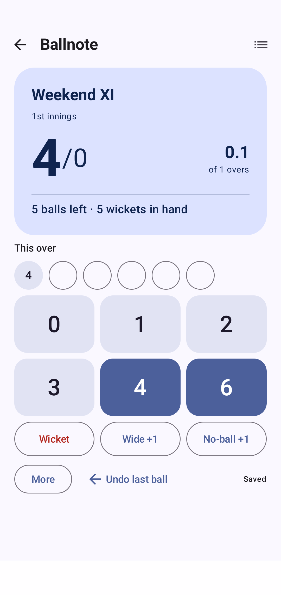
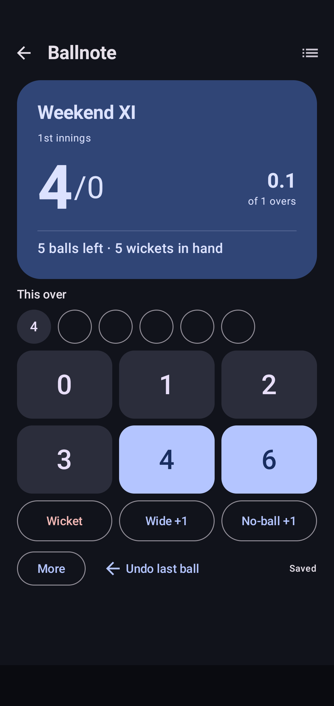

# Ballnote

**Tap. Score. Play.**

A local-only Android cricket scorer for casual turf matches. Set your rules, tap each delivery, and let Ballnote keep track of the score, overs, wickets and chase.

Built for team totals and quick updates between balls. No accounts, ads or server required.

[Releases](https://github.com/vkeerthivikram/Ballnote/releases) · [Release guide](RELEASES.md) · [Report a bug](https://github.com/vkeerthivikram/Ballnote/issues)

## A scoreboard you can glance at

<p>
  
  
</p>

Light and dark themes, captured on an Android emulator using a sample match.

## Features

| Feature | How it works |
| --- | --- |
| **One-tap scoring** | Large buttons for 0, 1, 2, 3, 4, 6, wickets, wides and no-balls. |
| **Combined outcomes** | Use **More** for extra runs, a no-ball hit for four, or runs completed before a wicket. |
| **Automatic chase calculations** | Follow the target, runs needed, balls remaining and final winning margin. |
| **Corrections with a preview** | Undo the latest delivery, or edit/delete any delivery in either innings—even after a match finishes. |
| **Match history and rematches** | Resume unfinished games, review deliveries by over and reuse the previous match setup. |
| **Teams and records** | Save, rename or archive teams. Track played, won, lost, tied and no-result records, which update after corrections. |
| **Sharing and backups** | Generate a result image or export all teams and matches as JSON. |
| **Material You appearance** | System, Light and Dark themes, optional Android 12+ wallpaper colours, haptics and keep-screen-on. |

Scoring is team-only: there are no individual batter or bowler statistics.

## Install

**Requires Android 8.0 or later.**

1. Download a `Ballnote-v<VERSION>.apk` asset from [Releases](https://github.com/vkeerthivikram/Ballnote/releases).
2. Open it on your phone. If Android asks, allow installation from the app you used to open the APK.
3. Launch Ballnote and start a match. First launch and scoring work offline.

If no release is listed yet, [build locally](#build-from-source) or [publish one through GitHub Actions](#publish-a-release).

Switching from an earlier debug APK? Its signing key differs from release builds. Follow the [signing and upgrade instructions](RELEASES.md#signing) to preserve your matches.

## Score your first match

1. Tap **New match**. Choose saved teams or enter two names, then set the batting order, overs and wicket limit.
2. Choose your wide/no-ball rule and tap **Start match**.
3. Tap the outcome after each delivery. Use **More** for combined outcomes and **Undo last ball** for an immediate correction.
4. At the innings break, tap **Start chase**. Ballnote sets the target and calculates the requirement automatically.
5. Open match details to review or correct deliveries, share the result, or start a rematch.

Every scoring action saves automatically. Reopening Ballnote resumes the most recently opened unfinished match; other unfinished games remain available in **Matches**. Match details also lets you end the first innings early or abandon a match as **No result**.

### Your turf, your extras rule

The default setup is **6 overs, 5 wickets, and +1 with the ball bowled again**. Overs and the wicket limit are adjustable during setup.

| Wide / no-ball mode | Runs added | Uses a ball? |
| --- | --- | --- |
| **Bowl again** | 1, plus additional runs entered | No |
| **Count the ball** | 1, plus additional runs entered | Yes |
| **Bowl again in final over** | 1, plus additional runs entered | Yes earlier in the innings; no in the final scheduled over |

The selected rule applies to both wides and no-balls. The scorer records the outcome agreed on the turf; Ballnote does not enforce dismissal types or free hits.

## Your data stays with you

- Matches and teams live in the phone's local database. The app has no internet permission, analytics or remote assets.
- Automatic Android cloud backup and device transfer are excluded. Export a backup before uninstalling the app or changing phones.
- **Settings → Export backup** saves teams, matches, rules and deliveries as JSON. Appearance preferences are not included.
- **Restore backup** validates the file and asks for confirmation before replacing current teams and matches. It does not merge them. The current format is version 1, with a 25 MB import limit.
- Sharing generates a PNG locally and opens Android's Sharesheet. Export uses the system file picker; you choose the destination, including any cloud provider offered by your phone.

## Build from source

### Requirements

| Tool | Version |
| --- | --- |
| JDK | 21 |
| Android SDK platform | 36 |
| Android SDK Build-Tools | 36.0.0 |
| Gradle | 8.13, supplied through the wrapper |

Clone the repository and open it in Android Studio, or use the command line:

```sh
git clone https://github.com/vkeerthivikram/Ballnote.git
cd Ballnote
```

Configure `JAVA_HOME` for JDK 21 and make the Android SDK available through `ANDROID_HOME` or Android Studio's generated `local.properties`.

**Windows / PowerShell**

```powershell
.\gradlew.bat testDebugUnitTest assembleDebug lintDebug
```

**macOS / Linux**

```sh
./gradlew testDebugUnitTest assembleDebug lintDebug
```

The debug APK is generated at `app/build/outputs/apk/debug/app-debug.apk`. With a phone or emulator connected, install it using:

```sh
adb install -r app/build/outputs/apk/debug/app-debug.apk
```

The optional Windows helper, `build.ps1`, selects this workspace's project-local toolchain when available. Downloaded tools are not committed to Git. Building needs internet for initial dependency downloads; the installed app runs locally.

### Inside the app

Ballnote uses **Kotlin**, **Jetpack Compose / Material 3**, **Room** and **DataStore**. A plain Kotlin scoring engine calculates scores and results from ordered deliveries. Team records derive from those results, so editing a delivery also updates the match outcome and team history.

Room stores scoring data transactionally; DataStore holds preferences. The exported database schema lives in `app/schemas`. Future schema changes must include migrations to preserve saved matches.

## Tests and validation

Unit tests cover extras modes, innings boundaries, wins and ties, combined outcomes, correction previews, reopened matches, team records and backup validation. The build commands above also run Android lint.

Device tests cover a complete scoring flow, persistence after reopening storage, replacement restore and local result-image generation. With a clean emulator or test device connected, run:

```powershell
.\gradlew.bat connectedDebugAndroidTest
```

On macOS/Linux, use `./gradlew` instead. Device tests create sample matches and expect a clean installation; follow the [test reset instructions](VALIDATION.md#repeat) when rerunning them.

See [VALIDATION.md](VALIDATION.md) for recorded results and remaining physical-device checks.

## Publish a release

1. Open [Actions → Release APK](https://github.com/vkeerthivikram/Ballnote/actions/workflows/release.yml) and choose **Run workflow** on `main`.
2. Enter a version without the `v` prefix, such as `1.0.0`. Choose whether it is a prerelease.
3. Leave **Publish a tag and GitHub Release** checked to publish, or uncheck it for a build-only run.

The workflow runs unit tests and release lint, builds and verifies a signed APK, then attaches the APK and `SHA256SUMS.txt` to a release with a matching tag, such as `v1.0.0`. Publication is manual; pushing commits alone does not publish an APK.

See [RELEASES.md](RELEASES.md) for signing secrets, versioning and upgrade details. Signing files and credentials must stay private.

## Project notes

| Document | Purpose |
| --- | --- |
| [Product brief](PRODUCT.md) | Intended use and feature boundaries |
| [Design system](DESIGN.md) | Colours, typography and interaction conventions |
| [Release guide](RELEASES.md) | Publishing, signing and versioning |
| [Validation report](VALIDATION.md) | What was checked and what still needs testing |

Found a scoring issue? [Open an issue](https://github.com/vkeerthivikram/Ballnote/issues) with the match rules, deliveries involved, and expected versus actual score. Include your Android and app versions when reporting a device problem.
